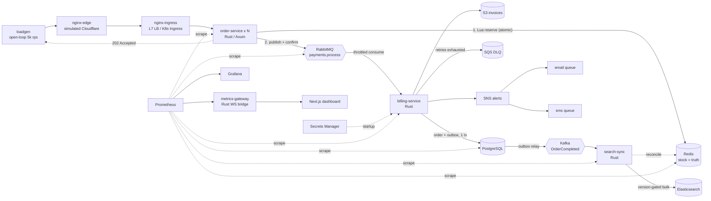

# PShop Engine

A distributed e-commerce **simulation engine** built to answer one question: *how does a backend absorb a 5,000+ req/s order spike, survive slow databases, and stay correct when pieces fail?*

It is deliberately not CRUD. The interesting parts are the hot path, the back-pressure chain behind it, and what happens at each failure boundary. See [`docs/FAILURE_MODES.md`](docs/FAILURE_MODES.md).

## Architecture



### The one idea that makes 5 ms possible

The order handler does **two** network hops and nothing else:

1. one Lua script on Redis: stock check, decrement, idempotency check, price lookup, atomically;
2. one publisher-confirmed publish to RabbitMQ: the durable hand-off.

Postgres, S3, Kafka and Elasticsearch are all *behind* the queue. A slow database cannot slow the order path; it can only make the queue longer, and the queue has a hard cap that converts "too slow" into a clean `503` instead of a memory leak.

### Back-pressure chain (outermost to innermost)

| Layer | Mechanism | What the client sees |
|---|---|---|
| Edge | per-IP rate limit (`edge.conf`) | `429` |
| order-service | `MAX_INFLIGHT` semaphore, `try_acquire` (no queueing) | `503 overload` |
| RabbitMQ | `x-max-length` + `x-overflow: reject-publish` → publisher NACK | `503 queue_full` (stock released) |
| billing-service | `basic_qos` prefetch + token bucket (`BILLING_MAX_RPS`) | nothing: the queue absorbs it |
| search-sync | consumer stops when ES is down; lag accrues in Kafka, not memory | nothing |

### Consistency model

* **Redis is the source of truth for stock.** Postgres holds settled orders; Elasticsearch is a derived projection.
* Every stock mutation carries a per-SKU **monotonic version**. ES applies an update only if its version is newer (scripted update), so Kafka redelivery and reordering are harmless.
* **Transactional outbox:** `OrderCompleted` is inserted in the *same* Postgres transaction as the order, then relayed to Kafka. No "order saved, event lost" window.
* **Idempotency end to end:** `Idempotency-Key` header → Redis `SET`; `ON CONFLICT DO NOTHING` on the order; deterministic S3 key; marker-guarded stock release.
* **Ambiguous publish (timeout) keeps the reservation.** Under-selling is recoverable, overselling is not.

## Repository layout

```
pshop-engine/
├── Cargo.toml                      Rust workspace
├── crates/
│   ├── common/                     shared contract: Redis keys + Lua, MQ topology, event schemas,
│   │                                 secrets (AWS Secrets Manager), metrics, config
│   ├── order-service/              hot path (Axum): reserve -> publish -> 202
│   ├── billing-service/            RabbitMQ consumer, invoice PDF, Postgres tx + outbox, Kafka relay, DLQ/SNS
│   ├── search-sync/                Kafka -> Elasticsearch, /v1/search, Redis reconcile loop
│   ├── metrics-gateway/            Prometheus -> WebSocket bridge for the dashboard
│   └── loadgen/                    open-loop traffic generator (HdrHistogram, hot-SKU skew, SLO gate)
├── migrations/                     orders + outbox (applied by billing-service at startup)
├── dashboard/                      Next.js (App Router) + TypeScript + Tailwind v4 + shadcn/ui
├── docker/                         multi-stage Dockerfiles (cargo-chef for Rust, standalone for Next)
├── docker-compose.yml              the whole stack on one machine
├── infra/
│   ├── nginx/                      edge.conf (simulated Cloudflare) + ingress.conf (LB)
│   ├── terraform/localstack/       S3, SQS DLQ, SNS fan-out, Secrets Manager
│   ├── k8s/                        kind config, Deployments, Services, HPAs, PDBs, Ingress, data plane, Prometheus
│   ├── prometheus/                 scrape config + alert rules
│   ├── grafana/                    provisioning + generated dashboard (scripts/gen_grafana.py)
│   └── rabbitmq/
├── scripts/gen_grafana.py          dashboard-as-code
└── docs/FAILURE_MODES.md
```

## Run it

**Docker Compose** (needs roughly 6-8 GB RAM):

```bash
make up                       # builds everything, applies Terraform to LocalStack
open http://localhost:8080          # the PShop storefront (through the simulated Cloudflare edge)
open http://localhost:8080/admin    # operations dashboard (live queue / stock / latency)
open http://localhost:3001    # Grafana (admin / admin)
make load RPS=5000 DURATION=60
```

**Kubernetes (kind):**

```bash
make kind-up kind-load kind-deploy
open http://localhost:8080
```

**Tests:** `make test` (needs `libcurl` headers and `cmake`, because librdkafka is built from source).

> **LocalStack note.** Since 2026-03-23 the *latest* LocalStack images require a (free-tier) auth token. The stack pins `localstack/localstack:4.12`, which predates that. To use a newer tag set `LOCALSTACK_TAG` and `LOCALSTACK_AUTH_TOKEN` in `.env`. I could not confirm from the vendor's announcement whether 4.12 runs without a token; check on first run.

## The storefront

`dashboard/` serves a customer-facing shop at `/` next to the ops view at `/admin`.

| Route | What it does |
|---|---|
| `/` | Live hero (the product under most pressure), a "right now" strip fed by the metrics gateway, then the 100-product catalogue with category, price, in-stock filters and sorting |
| `/products/[sku]` | Illustrated product page; stock polls `GET /v1/products/{sku}` (Elasticsearch real-time GET); add to cart or buy now |
| `/cart`, `/checkout` | Multi-item cart (browser storage). Checkout posts one `POST /v1/orders` per line with a per-line Idempotency-Key, so a retry after a timeout never reserves stock twice; partial failures (sold out, back-pressure) are shown per line |
| `/orders` | Live list: polls `GET /v1/order-status/{id}` for every unpaid order, shows queue wait, then "Paid" with the invoice PDF (`/v1/invoices/{id}`) |
| `/orders/[id]` | One order's pipeline: accepted, waiting for payment, invoice |

**The Engine panel** (button in the header, on every shop page) is the control room:

* live accepted/s, payments/s, queue depth and reply time from the metrics gateway WebSocket;
* **Send a crowd**: an open-loop generator in the browser (50 to 600 orders/s) that places real orders, with a live breakdown of accepted / sold out / rate-limited (429) / shed by back-pressure (503). A browser tops out at a few hundred requests a second; `make load` goes much higher;
* **Break the payment provider**: Normal / Slow / Down, via `PUT /v1/control/payments` on billing-service. Orders keep being accepted while payments stall, the queue grows and nothing is lost; flip back and it drains. The mode lives in Redis (all replicas obey it) and expires after 10 minutes. It only exists when billing runs with `CONTROL_ENABLED=true` (compose sets it; Kubernetes does not, and nginx/ingress there do not route it).

Try it: open the shop, open Engine, press **Send the crowd**, set the provider to **Down**, place an order yourself and watch it wait in the queue behind the crowd on `/orders`; set it back to **Normal** and watch it drain. For a visible sell-out set `SEED_STOCK_PER_SKU` low in `.env`, run `make down` (clears volumes) and `make up`.

`next dev` has no edge in front of it: set `API_ORIGIN=http://localhost:8080` and `NEXT_PUBLIC_WS_URL=ws://localhost:8080/ws` (see `dashboard/.env.example`).

## Capacity arithmetic (so the numbers are not magic)

Defaults in `docker-compose.yml`: billing drains **800 msg/s**, queue cap **500,000**.

* A 60 s flood (10 s ramp, then 5,000 rps) is ≈277,500 orders; billing drains 48,000 of them meanwhile, leaving about **229,500 queued**, under the cap.
* Backlog clears in 229,500 / 800 ≈ **4.8 min**. The dashboard's "202 → persisted p95" shows this directly.
* The queue reaches the 500,000 cap at **t ≈ 124 s** of sustained flood (a 120 s run ends just under it at ≈481,500). Run `make load DURATION=150` to watch the back-pressure chain engage: the system starts answering `503 queue_full` and releasing stock.
* Postgres sees ≤ 800 tx/s per billing replica regardless of edge traffic. That is the point of the throttle.

## What was verified, and what was not

Verified in the build environment:

* `cargo test --workspace` passes (unit tests for key layout, script reply parsing, invoice PDF structure/HMAC, ES bulk classification and coalescing, WS origin check, Prometheus parsing, loadgen ramp/skew).
* **Lua scripts against a real Redis**: reserve, idempotent replay, sold-out, no partial decrement, release, once-only release, and **200 concurrent buyers vs 50 units → exactly 50 accepted**.
* **order-service binary against real Redis, broker down**: readiness 503, publish failure releases stock/version/idempotency key, validation errors map to 400/404/422.
* **metrics-gateway binary → WebSocket**, against a stub Prometheus; frames match the dashboard's TypeScript types.
* Dashboard: `tsc` clean, `next build` succeeds with standalone output.
* Storefront driven in headless Chromium (browse, filter, cart, checkout, orders to paid, Engine panel with crowd and provider switch, mobile) against a **stateful mock API with the same HTTP/WebSocket contract**, not the real services. The billing control module has unit tests; its Redis path has not run against a real Redis.
* YAML/JSON configs parse; K8s selectors match their pod labels.

**Not run** (no Docker daemon, `kubectl`, `kind`, `terraform`, RabbitMQ, Kafka, Postgres or Elasticsearch in the build sandbox):

* the full compose/kind stacks and the Terraform apply;
* the 202 happy path, billing settle, outbox→Kafka, search-sync→ES, SNS fan-out, Secrets Manager fetch. These compile and are unit-tested where possible, but have not run against real brokers;
* **the < 5 ms p99 target.** It depends on hardware. On a laptop the load generator shares CPU with the system under test, so measure `pshop_order_accept_seconds` in Grafana (server-side) and treat loadgen's client-side number as an upper bound. `--slo-p99-ms` turns the SLO into a pass/fail gate.

Expect a first-run shakedown: the likeliest friction is version drift in the container images and LocalStack's token policy.

## Known simplifications

* One broker/DB/ES node each, `emptyDir` volumes in Kubernetes. Production would use managed, replicated services (the app only needs different URLs).
* The payment gateway is simulated (latency + random failures).
* Kafka/ES/Redis run unauthenticated on the private network; in-cluster credentials are dev dummies.
* The Billing HPA scales on CPU. Queue-depth scaling (KEDA) is included as a commented manifest because it needs an operator.
* Compose Prometheus scrapes three static order replicas; Kubernetes uses service discovery.
